# 🌀 Azure Streaming Pipeline: Hurricane Harvey Tweets

<p align="center"></p>

<p align="center"></p>

> A serverless Azure pipeline that ingests disaster tweets (text + images) over a REST API, lands the raw messages in Blob Storage, streams them through Event Hubs, and persists them in Cosmos DB for analytics. **It now runs entirely on your laptop with `docker compose up`, using Microsoft's own emulators.**

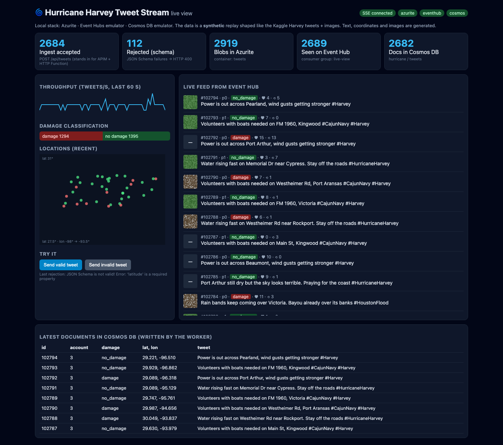

---

## Business case

During a disaster, responders need incoming posts and photos validated, stored and searchable while they still matter. This serverless Azure pipeline validates each post, keeps the raw copy in Blob Storage, streams it through Event Hubs and stores it in Cosmos DB, and the whole thing runs locally on emulators. The hard part in real use is a licensed data feed, not the pipeline. [docs/BUSINESS_CASE.md](docs/BUSINESS_CASE.md) covers the buyers, use cases, an illustrative ROI model and the limits.

## 1. The problem

During Hurricane Harvey (Aug 2017) people posted thousands of tweets and photos about flooding and damage. Responders need them **as they happen**: validated, stored, and queryable, with damage signals surfaced quickly.

## 2. Architecture in Azure (original design)

<p align="center"></p>

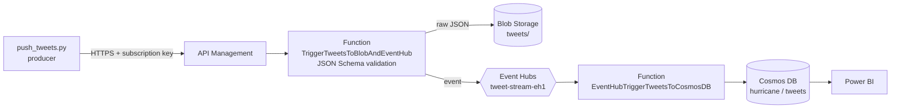

The functions live in [`azure-func/function_app.py`](azure-func/function_app.py) and use the **Azure Functions Python v2 programming model** (decorators, no `function.json`; see [section 4](#4-azure-functions-python-v2)). They also run locally, on the real Functions host, against the emulators. The original write-up (Kaggle preprocessing, Azure portal screenshots) is preserved in [docs/ORIGINAL_README.md](docs/ORIGINAL_README.md).

## 3. The same pipeline, locally

Every Azure service has a local stand-in. The Azure SDKs are the real ones; only the connection strings change.

| Azure service | Local stand-in | Port(s) |
|---|---|---|
| API Management + HTTP Function | `api` (FastAPI), using the **same** schema code as the function (`azure-func/shared_code`) | 8000 |
| Blob Storage | [Azurite](https://learn.microsoft.com/azure/storage/common/storage-use-azurite) | 10000-10002 |
| Event Hubs | [Event Hubs emulator](https://learn.microsoft.com/azure/event-hubs/overview-emulator) (config in [`emulators/eventhubs-config.json`](emulators/eventhubs-config.json)) | 5672 AMQP, 9092 Kafka |
| Both Azure Functions (v2 model) | `functions`: the real Azure Functions 4.x host (`mcr.microsoft.com/azure-functions/python:4-python3.12`) running `azure-func/function_app.py` against the emulators | 7071 |
| Event Hub → Cosmos Function (feeds the live view) | `worker`: Event Hub consumer (`cosmos-writer` group, checkpoints in Azurite) that upserts into Cosmos | – |
| Cosmos DB (NoSQL) | [Cosmos DB Linux emulator (vNext)](https://learn.microsoft.com/azure/cosmos-db/emulator-linux), works on arm64 and x64 | 8081, Data Explorer 1234 |
| Power BI | `frontend`: React live view (Vite + TypeScript, served by nginx) | 3000 |
| push_tweets.py | `producer`: replays the stream at 2 tweets/s, with every 25th tweet deliberately invalid | – |

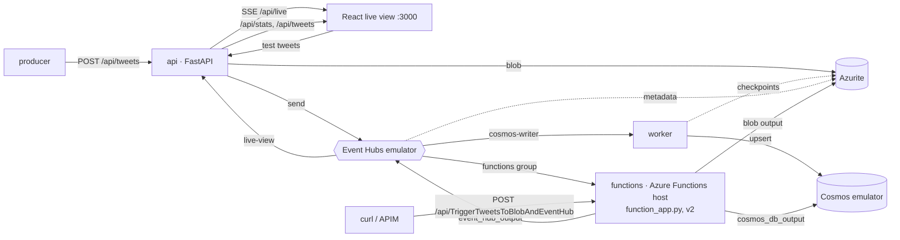

### Message lifecycle

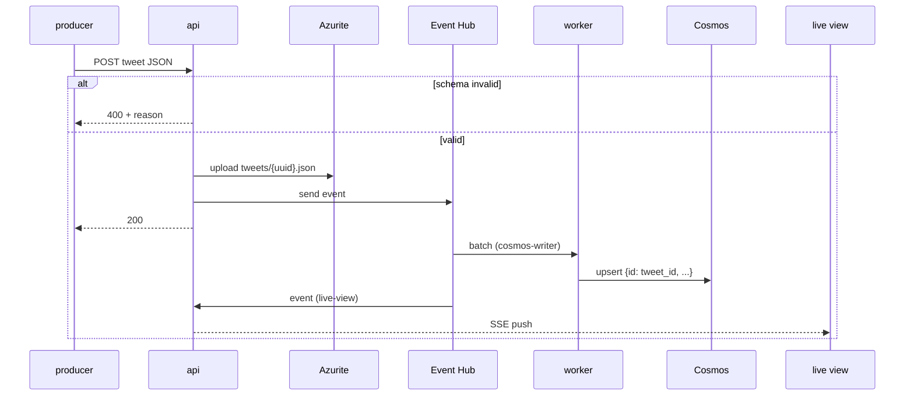

## 4. Azure Functions: Python v2

Both functions are declared with decorators in one file, [`azure-func/function_app.py`](azure-func/function_app.py). The old `function.json` folders were moved (not deleted) to [`legacy/v1-functions/`](legacy/v1-functions).

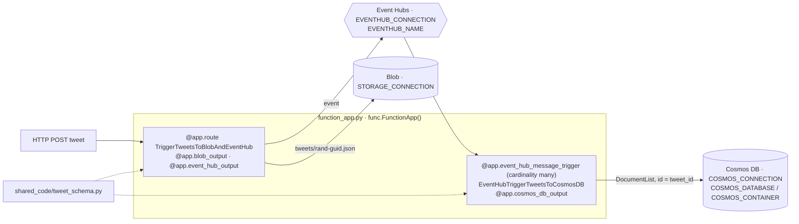

| | v1 (before) | v2 (now) |
|---|---|---|
| Definition | `function.json` + `__init__.py` per function | decorators in `function_app.py` |
| Extension bundle | `[3.*, 4.0.0)` (deprecated) | `[4.0.0, 5.0.0)` |
| Cosmos binding | `collectionName`, `connectionStringSetting` (extension 3.x) | `container_name`, `connection` (extension 4.x) |
| Python | 3.9 dev container | 3.12 (host image and dev container) |

**App settings to set in Azure** (the v1 setting names were renamed): `STORAGE_CONNECTION`, `EVENTHUB_CONNECTION`, `EVENTHUB_NAME`, `EVENTHUB_FUNCTIONS_CONSUMER_GROUP` (`$Default` works), `COSMOS_CONNECTION`, `COSMOS_DATABASE`, `COSMOS_CONTAINER`. Optional: `HTTP_AUTH_LEVEL` (defaults to `function`; only the local compose host sets `anonymous`). `AzureWebJobsFeatureFlags=EnableWorkerIndexing` is **not** needed on the 4.x runtime. For `func start` outside Docker, copy [`azure-func/local.settings.example.json`](azure-func/local.settings.example.json) to `local.settings.json` (git-ignored) and fill in the emulator keys.

Gotcha found while running it: annotate the Event Hub batch as `typing.List[func.EventHubEvent]`. With the builtin `list[...]` the worker's indexer silently registered zero functions.

**The real host, running locally.** The `functions` service is the official Functions host image. It is published for amd64 only, so on Apple silicon it runs under emulation (`platform: linux/amd64`).


Its own log, with both functions executing against Azurite, the Event Hubs emulator and the Cosmos emulator:

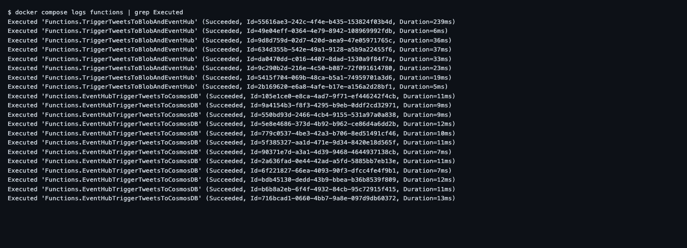

Try it:

```bash
curl -X POST http://localhost:7071/api/TriggerTweetsToBlobAndEventHub -d '{"tweet_id": 1}'   # 400 + schema error
```

## 5. Run it

```bash
cp .env.example .env    # optional: defaults already target the emulators
docker compose up --build
```

| URL | What |
|---|---|
| http://localhost:3000 | Live view |
| http://localhost:8000/docs | API (OpenAPI) |
| http://localhost:1234 | Cosmos DB Data Explorer |
| http://localhost:7071 | Azure Functions host (v2 app) |

The first start takes about 30-60 s (the Functions host a little longer under emulation) while the emulators boot. The api waits until all three are ready (`/health` reports each one), then the producer starts. Stop everything with `docker compose down`.

> **Event Hubs emulator license.** Running the emulator requires accepting Microsoft's [emulator license terms](https://github.com/Azure/azure-event-hubs-emulator-installer/blob/main/EMULATOR_EULA.txt). `docker-compose.yml` passes `ACCEPT_EULA=Y` by default through `EVENTHUBS_EMULATOR_ACCEPT_EULA`.

> **About the credentials in `stream/config.py`.** These are the *publicly documented* emulator defaults (Azurite `devstoreaccount1`, Event Hubs `SAS_KEY_VALUE`, the Cosmos emulator key). They are not secrets. To target real Azure, set the variables listed in `.env.example` in a `.env` that you never commit.

## 6. What you see

**Live view.** It shows a counter for each pipeline stage, a throughput sparkline, the damage split, a map of where tweets came from, the live Event Hub feed (with image tiles), and the newest Cosmos documents:


**Schema enforcement.** The *Send invalid tweet* button posts a tweet with no latitude. The api returns HTTP 400 with the same message the Azure Function produces:

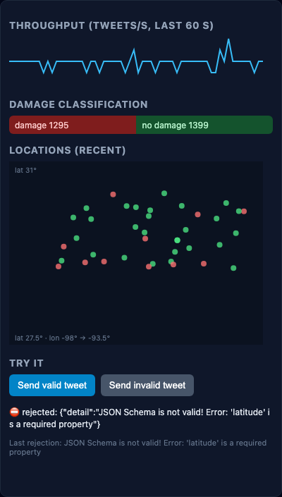

**Cosmos DB emulator.** The Data Explorer shows the `hurricane` database the worker created:

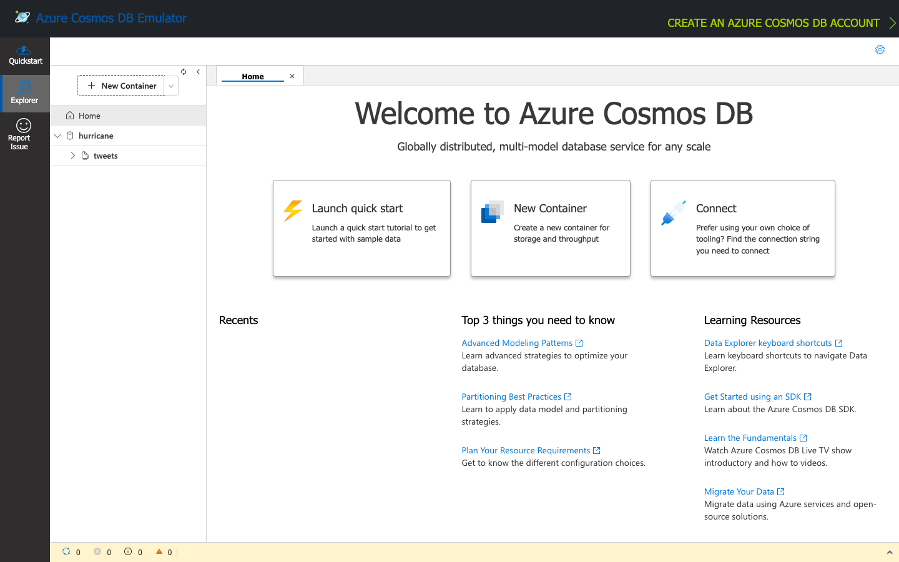

**API:**

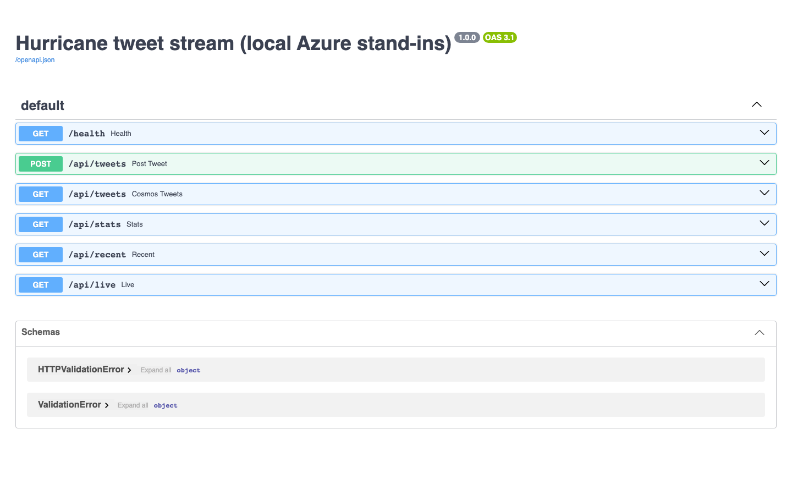

Screenshots are real, captured headless from the running stack with `uv run --no-project --with playwright python scripts/screenshots.py`.

## 7. Data: synthetic by default

The original Kaggle datasets (Harvey tweets plus satellite damage images) need a Kaggle login and are not redistributable, so they are not in the repo. Locally, `stream/sample.py` generates a **deterministic synthetic stream** of 500 tweets in the same shape: templated Harvey-style text, coordinates around the Texas Gulf coast, a `damage_flag`, and a small generated PNG tile on about 60% of tweets. **None of it is real tweet or image data.**

To replay the real stream, run the original preprocessing (`preprocessing/scripts`, see [docs/ORIGINAL_README.md](docs/ORIGINAL_README.md)) and point the producer at the output:

```bash
SAMPLE_PATH=/data/merged_tweets_image_metadata_stream.json  # mount it into the producer container
```

## 8. Fixes made along the way

- **The Event Hub → Cosmos function lost data.** It called `outputDocument.set()` once per event, so each batch kept only its last tweet. It now writes the whole batch as a `DocumentList`.
- **Shared validation.** The HTTP function's schema check (400 on bad JSON or schema failure) moved into `shared_code/`, so the local api enforces exactly the same contract. A stray `ValueError` used to fall through and return nothing; it now returns a 400 too.
- Cosmos documents get `id = str(tweet_id)`, so retries upsert instead of duplicating.
- `push_tweets.py` defaults to the local api when `HURRICANE_API_URL` is unset.

## 9. Project layout

```
azure-func/            Azure Functions, Python v2 model (function_app.py) + shared_code/ schema + Dockerfile
stream/                local stand-ins: api, worker, producer, sample data, config
frontend/              React live view (Vite + TS, nginx)
emulators/             Event Hubs emulator config
tests/                 pytest: schema, sample, function bindings, api
preprocessing/         original Kaggle preprocessing scripts
legacy/                moved, not deleted: v1 function.json functions, HttpTrigger1 template, old requirements.txt
docs/                  original README, screenshots
```

## 10. Tests and CI

```bash
uv sync && uv run pytest -q   # 15 tests, no emulators needed
```

GitHub Actions runs the unit tests and the frontend type-check and build, then `docker compose build`, then a smoke test that boots the real Functions host on Azurite and the Event Hubs emulator and checks the v2 HTTP function returns 400 for an invalid tweet.
