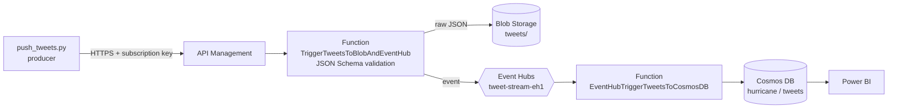
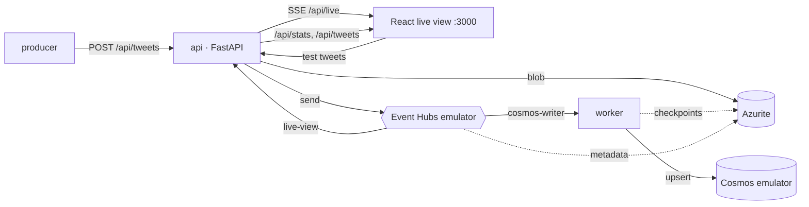
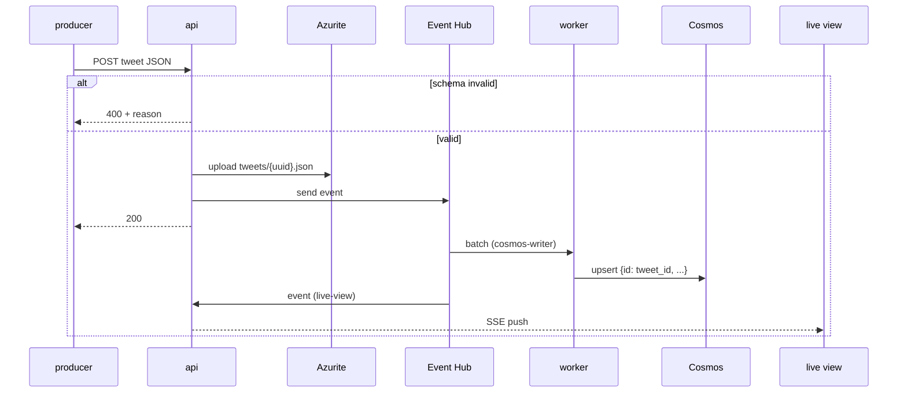

# 🌀 Azure Streaming Pipeline: Hurricane Harvey Tweets

<p align="center"></p>

> A serverless Azure pipeline that ingests disaster tweets (text + images) over a REST API, lands the raw messages in Blob Storage, streams them through Event Hubs, and persists them in Cosmos DB for analytics. **It now runs entirely on your laptop with `docker compose up`, using Microsoft's own emulators.**


---

## 1. The problem

During Hurricane Harvey (Aug 2017) people posted thousands of tweets and photos about flooding and damage. Responders need them **as they happen**: validated, stored, and queryable, with damage signals surfaced quickly.

## 2. Architecture in Azure (original design)

<p align="center"></p>



The functions are still in [`azure-func/`](azure-func) and can be deployed as before. The original write-up (Kaggle preprocessing, Azure portal screenshots) is preserved in [docs/ORIGINAL_README.md](docs/ORIGINAL_README.md).

## 3. The same pipeline, locally

Every Azure service has a local stand-in. The Azure SDKs are the real ones; only the connection strings change.

| Azure service | Local stand-in | Port(s) |
|---|---|---|
| API Management + HTTP Function | `api` (FastAPI), using the **same** schema code as the function (`azure-func/shared_code`) | 8000 |
| Blob Storage | [Azurite](https://learn.microsoft.com/azure/storage/common/storage-use-azurite) | 10000-10002 |
| Event Hubs | [Event Hubs emulator](https://learn.microsoft.com/azure/event-hubs/overview-emulator) (config in [`emulators/eventhubs-config.json`](emulators/eventhubs-config.json)) | 5672 AMQP, 9092 Kafka |
| Event Hub → Cosmos Function | `worker`: Event Hub consumer (`cosmos-writer` group, checkpoints in Azurite) that upserts into Cosmos | – |
| Cosmos DB (NoSQL) | [Cosmos DB Linux emulator (vNext)](https://learn.microsoft.com/azure/cosmos-db/emulator-linux), works on arm64 and x64 | 8081, Data Explorer 1234 |
| Power BI | `frontend`: React live view (Vite + TypeScript, served by nginx) | 3000 |
| push_tweets.py | `producer`: replays the stream at 2 tweets/s, with every 25th tweet deliberately invalid | – |



### Message lifecycle



## 4. Run it

```bash
cp .env.example .env    # optional: defaults already target the emulators
docker compose up --build
```

| URL | What |
|---|---|
| http://localhost:3000 | Live view |
| http://localhost:8000/docs | API (OpenAPI) |
| http://localhost:1234 | Cosmos DB Data Explorer |

The first start takes about 30-60 s while the emulators boot. The api waits until all three are ready (`/health` reports each one), then the producer starts. Stop everything with `docker compose down`.

> **Event Hubs emulator license.** Running the emulator requires accepting Microsoft's [emulator license terms](https://github.com/Azure/azure-event-hubs-emulator-installer/blob/main/EMULATOR_EULA.txt). `docker-compose.yml` passes `ACCEPT_EULA=Y` by default through `EVENTHUBS_EMULATOR_ACCEPT_EULA`.

> **About the credentials in `stream/config.py`.** These are the *publicly documented* emulator defaults (Azurite `devstoreaccount1`, Event Hubs `SAS_KEY_VALUE`, the Cosmos emulator key). They are not secrets. To target real Azure, set the variables listed in `.env.example` in a `.env` that you never commit.

## 5. What you see

**Live view.** It shows a counter for each pipeline stage, a throughput sparkline, the damage split, a map of where tweets came from, the live Event Hub feed (with image tiles), and the newest Cosmos documents:


**Schema enforcement.** The *Send invalid tweet* button posts a tweet with no latitude. The api returns HTTP 400 with the same message the Azure Function produces:


**Cosmos DB emulator.** The Data Explorer shows the `hurricane` database the worker created:


**API:**


Screenshots are real, captured headless from the running stack with `uv run --with playwright python scripts/screenshots.py`.

## 6. Data: synthetic by default

The original Kaggle datasets (Harvey tweets plus satellite damage images) need a Kaggle login and are not redistributable, so they are not in the repo. Locally, `stream/sample.py` generates a **deterministic synthetic stream** of 500 tweets in the same shape: templated Harvey-style text, coordinates around the Texas Gulf coast, a `damage_flag`, and a small generated PNG tile on about 60% of tweets. **None of it is real tweet or image data.**

To replay the real stream, run the original preprocessing (`preprocessing/scripts`, see [docs/ORIGINAL_README.md](docs/ORIGINAL_README.md)) and point the producer at the output:

```bash
SAMPLE_PATH=/data/merged_tweets_image_metadata_stream.json  # mount it into the producer container
```

## 7. Fixes made along the way

- **The Event Hub → Cosmos function lost data.** It called `outputDocument.set()` once per event, so each batch kept only its last tweet. It now writes the whole batch as a `DocumentList`.
- **Shared validation.** The HTTP function's schema check (400 on bad JSON or schema failure) moved into `shared_code/`, so the local api enforces exactly the same contract. A stray `ValueError` used to fall through and return nothing; it now returns a 400 too.
- Cosmos documents get `id = str(tweet_id)`, so retries upsert instead of duplicating.
- `push_tweets.py` defaults to the local api when `HURRICANE_API_URL` is unset.

## 8. Project layout

```
azure-func/            Azure Functions (deployable) + shared_code/ schema
stream/                local stand-ins: api, worker, producer, sample data, config
frontend/              React live view (Vite + TS, nginx)
emulators/             Event Hubs emulator config
tests/                 pytest: schema, sample, function bindings, api
preprocessing/         original Kaggle preprocessing scripts
legacy/                moved, not deleted: HttpTrigger1 template, old requirements.txt
docs/                  original README, screenshots
```

## 9. Tests and CI

```bash
uv sync && uv run pytest -q   # 12 tests, no emulators needed
```

GitHub Actions runs the unit tests and the frontend type-check and build, then `docker compose build`.
